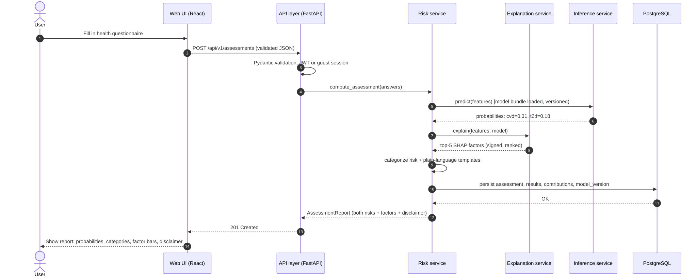

# Architecture Description — MedRisk

**Version:** 0.1 (draft) · **Stage:** pre-defense 0 · **Date:** 19 October 2026
**Alignment:** every component below traces to a requirement (FR-xx/NFR-xx) — see §5.

The diagrams follow a C4-like progressive decomposition. **Editable sources** (Mermaid):
`docs/architecture/diagrams/*.mmd` — they render inline in this document and in GitHub.
Readable exports (SVG) are generated into `docs/architecture/diagrams/export/` by
`scripts/render-diagrams.sh`.

---

## 1. System context (level 1)

*Source: [system-context.mmd](diagrams/system-context.mmd)*

The system has one primary actor (the adult user), a secondary human actor (healthcare
professional / administrator, later stages) and interacts with: a PostgreSQL database,
an offline data source (public medical datasets, ingested by the training pipeline), and
(optionally, future work) an external LLM API for free-text explanations.

## 2. Use-case diagram (functional scope)

*Source: [use-case.mmd](diagrams/use-case.mmd)*

Actors: **Guest** (fill questionnaire, calculate risk, register), **Registered user**
(all guest rights + view report, get explanations, view history, manage profile),
**Admin** (manage users, manage model metadata, review data/model quality).
Note the `«include»`-style dependency: *view risk report* always follows *calculate risk*.

## 3. Component diagram (level 2, draft)

*Source: [component.mmd](diagrams/component.mmd)*

| Component | Responsibility | Requirements |
|---|---|---|
| Web UI (React SPA) | Questionnaire, report, history, admin views | FR-01…FR-08, NFR-05 |
| API layer (FastAPI) | Routing, validation (Pydantic), auth middleware, OpenAPI | FR-01, FR-05, FR-13, NFR-03 |
| Risk service | Orchestrates inference + explanation for one assessment | FR-02, FR-04 |
| Explanation service | SHAP attribution → ranked factors + text templates | FR-04, NFR-06 |
| History service | Persist/read assessments, trends, deletion | FR-06, FR-07, NFR-04 |
| Auth service | Registration, login, JWT, password hashing | FR-05, NFR-03 |
| Inference service | Loads the versioned model bundle, predicts probabilities | FR-02, FR-09, NFR-08 |
| Data pipeline (pandas) | Download, clean, impute, encode, split | FR-10, NFR-12 |
| Training pipeline (sklearn/LightGBM) | Train, tune, evaluate, write model bundle + metrics | FR-10, NFR-07, NFR-09 |
| PostgreSQL | Users, assessments, results, factor contributions, model registry | NFR-04, NFR-08 |

## 4. Data model (ER diagram)

*Source: [er-diagram.mmd](diagrams/er-diagram.mmd)*

Key decisions: `assessment` stores the questionnaire snapshot (auditability), `risk_result`
stores probability + category + the model version that produced it (NFR-08), and
`factor_contribution` stores per-factor SHAP values (FR-04). Guests are supported by
storing an anonymous `session_id` instead of `user_id`.

## 5. Key interaction sequence (assessment flow)

*Source: [sequence-assessment.mmd](diagrams/sequence-assessment.mmd)*

## 6. Architectural style and quality attributes

- **Style:** modular monolith (single FastAPI application with strictly separated service
  modules), because a 3-person team deploying on one host must minimize operational
  complexity (tech comparison D5). Boundaries are kept service-like so the inference
  component can be extracted into a separate process later.
- **Data flow:** batch (offline) for training; synchronous request/response for inference.
- **Security:** stateless JWT auth; password hashing; no secrets in the repo (NFR-03).
- **Reproducibility:** model bundles are versioned artifacts; training is seeded (NFR-12).
- **Explainability:** SHAP computed inside the inference path but cached per model version
  (background dataset) to stay within the p95 latency budget (NFR-01).

## 7. Draft status and open questions

Component diagram is a **draft** for pre-defense 0. Open questions to confirm with the
supervisor: (1) separate microservice for inference vs. in-process loading;
(2) whether the trend chart (FR-07) needs server-side aggregation in v1;
(3) hosting for the diploma period (university server vs. cloud).
